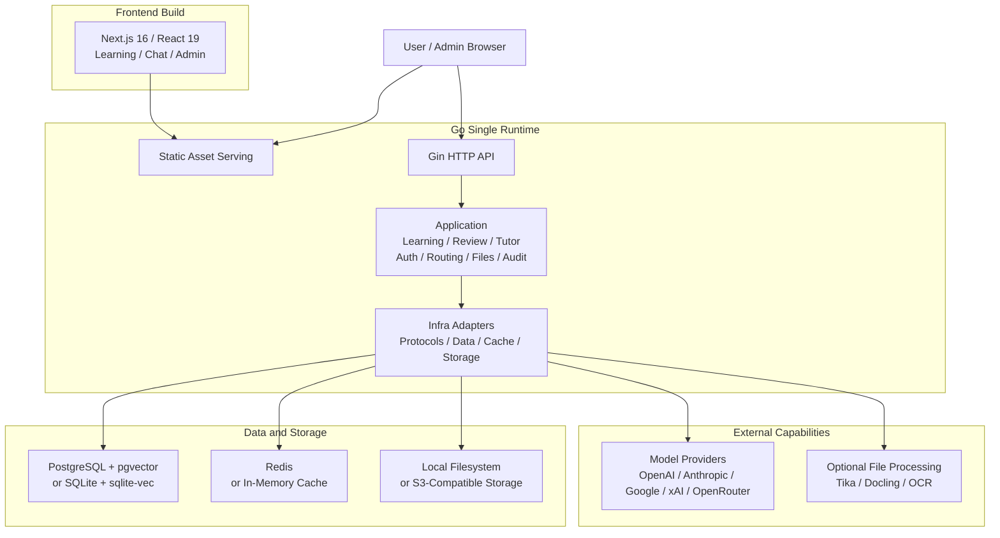

<p align="center">
  <picture>
    <source media="(prefers-color-scheme: dark)" srcset="./apps/web/public/logo-white.svg" />
    
  </picture>
</p>

<p align="center">
  课知伴 — an AI learning companion for Signals and Systems.
</p>

<p align="center">
  English | <a href="./docs/README.zh-CN.md">简体中文</a>
</p>

<p align="center">
  <a href="https://github.com/WangXingFan/CourseMate"></a>
  <a href="https://github.com/WangXingFan/CourseMate/actions/workflows/ci.yml"></a>
  <a href="https://www.apache.org/licenses/LICENSE-2.0"></a>
  
  
  
</p>

## Overview

课知伴 is an open-source, self-hosted learning companion for students studying **Signals and Systems**. It combines interactive lessons, chapter experiments, course-aware assistance, quizzes, and mistake review in one workspace. Students can make a prediction, adjust a signal, inspect the result, and reinforce their understanding through variant exercises and scheduled review.

The learning tools share an existing platform for AI conversations, teaching-material retrieval, model routing, account management, and administration. The browser frontend and Go API can run together in one Docker container; a Tauri desktop client is also available.

## Learning Workflow

```text
Learn a concept → Predict → Run an experiment → Read hints and explanations
                                                      ↓
Review when due ← Practice a variant ← Diagnose a mistake ← Take a quiz
```

## Features

| Area | Capabilities |
| --- | --- |
| Interactive lessons | Eight topics: convolution, sampling, Fourier series, first-order systems, Fourier transform, Laplace transform, second-order systems, and modulation. |
| Knowledge and staged practice | 52 curated Chinese notes; every published section exposes preparation, in-class and follow-up questions (156 authored exercises), including numeric/coefficient exercises with fraction input, formula preview, partial credit and account-owned results. |
| Chapter experiments and tutor | Signal basics, time domain, frequency domain, and s-domain experiments. Curated hints before answering; AI explanations after answering, with course citations and a curated fallback when a model is unavailable. |
| Signal workbench | Step, finite-width impulse approximation, rectangle, exponential, and sine signals; reversal, scaling, and shifting; view A/B, add, subtract, multiply, or compute numerical convolution. |
| Quizzes and diagnosis | 12 base questions, 36 bilingual misconception diagnoses, 24 server-graded variant exercises, and account-scoped attempt history. |
| Spaced review | Due-date filters, review stages, original-question retry, and variant practice. Review intervals progress through 1, 3, 7, 14, and 30 days, with incorrect variant answers restarting the schedule. |
| Teaching materials and AI chat | Knowledge-base retrieval, traceable sources, file parsing, streaming conversations, and configurable model providers. |
| Accounts and administration | User and role management, model authorization, upstream routing, authentication, and audit logs. |
| Clients and deployment | Chinese and English interfaces, browser and Tauri desktop clients, Docker, SQLite or PostgreSQL, and in-memory cache or Redis. |

## Learning Pages

Open these paths on your deployed instance after signing in:

| Path | Purpose |
| --- | --- |
| `/learn` | Learning hub and topic navigation. |
| `/learn/knowledge` | Search the 52 published course notes and complete their three practice stages. |
| `/learn/experiments` | Four chapter experiments with hints and explanations. |
| `/learn/workbench` | Build, transform, and combine signals. |
| `/learn/quiz` | Quick quizzes and original-question practice. |
| `/learn/progress` | Attempt history, misconception diagnosis, variant exercises, and due reviews. |

For AI-generated experiment explanations, an administrator must configure and authorize a model and its upstream channel. Curated hints and fallback explanations remain available without a model. Teaching-material retrieval additionally requires uploaded materials and an embedding configuration.

P0 (stages 0–3) is implemented. See the [delivery and validation record](./docs/LEARNING-P0-DELIVERY.zh-CN.md) for CI evidence and numerical limits. The [course content package](./content/signals/README.md) preserves the imported source, documents corrections and contains 52 curated notes. Knowledge bases are created and populated manually; to retrieve these course notes in chat, upload the Markdown files from `content/signals/knowledge-base/` to a knowledge base and configure Embedding. Course browsing and deterministic practice work without an AI model. Full derivation checks, handwriting grading, unified activity tracking, expanded discrete-time topics, experiment reports and teacher analytics remain on the [roadmap](./docs/COURSEMATE-LEARNING-ROADMAP.zh-CN.md).

## Architecture and Tech Stack

CourseMate uses a split frontend/backend development model with a single-runtime deployment path. The frontend is built into static assets and served by the Go service, while APIs, authorization, model routing, files, and audit capabilities run in the same backend runtime. Heavy document extraction and OCR capabilities are optional services, keeping the base deployment lightweight.



| Layer | Responsibility | Technologies |
| --- | --- | --- |
| Frontend | Interactive learning, chat, admin console, and static builds | Next.js 16, React 19, TypeScript, Tailwind CSS, Shadcn/UI, Streamdown, KaTeX, Mermaid, Recharts, Motion |
| Backend runtime | APIs, authentication, authorization, orchestration, protocol adaptation, and static serving | Go 1.26, Gin, Gorm, Swagger, OpenTelemetry, Zap |
| Data and cache | Domain data, vector retrieval, session state, and runtime cache | PostgreSQL, pgvector, SQLite, sqlite-vec, Redis, in-memory cache |
| Files and storage | Uploaded files, generated files, object storage, and local persistence | Local filesystem, S3-compatible object storage |
| File processing | Text extraction, OCR, document parsing, and LLM OCR fallback | Built-in extractors, Apache Tika, Docling, RapidOCR, Tesseract OCR, Paddle OCR, cloud OCR adapters, MinerU |
| Deployment runtime | Lightweight single-node deployment or multi-node production deployment | Docker, Docker Compose, SQLite/in-memory cache, PostgreSQL/Redis |

The backend keeps clear internal boundaries: `backend/cmd/server` is the executable entrypoint, `backend/internal/cli` owns process startup, `backend/internal/app` assembles and wires the application, and `backend/internal/transport/http` owns the HTTP boundary. Requests then flow through `application` use cases to consumer-owned `repository` or `ports` interfaces and their `infra` implementations. The data layer uses domain-prefixed tables, while financial records, audit trails, system events, and high-growth vector data remain separate sources of truth.

## Repository Layout

```text
.
├── backend/                  # Go API and single-runtime server
│   ├── cmd/server/            # executable entrypoint
│   ├── internal/
│   │   ├── cli/               # process startup
│   │   ├── app/               # dependency wiring and lifecycle
│   │   ├── application/       # use cases and orchestration
│   │   ├── domain/            # business concepts and rules
│   │   ├── ports/              # outbound integration contracts
│   │   ├── repository/         # persistence contracts
│   │   ├── infra/              # persistence, cache, storage, providers
│   │   ├── transport/http/     # handlers, DTOs, middleware, routes
│   │   └── shared/             # cross-cutting response and security code
│   └── docs/                  # generated Swagger artifacts
├── apps/                     # client applications (one directory per platform)
│   ├── web/                  # Next.js App Router and static export
│   │   ├── app/              # route entries and layouts
│   │   ├── features/         # learning, chat, and administration workflows
│   │   ├── entities/         # reusable business entities
│   │   ├── shared/           # API, auth, UI, hooks, models, utilities
│   │   ├── components/       # UI primitives and visual components
│   │   └── public/           # static assets
│   └── desktop/              # Tauri 2 shell: tray, deep links, auto-update, OS keychain
├── packages/
│   ├── api-contract/         # generated TypeScript API contract (single source for all clients)
│   └── core/                 # platform-agnostic client logic shared by web / desktop / mobile
├── deploy/                    # Docker deployment: compose profiles, config templates, optional services
├── docs/                      # project guides and screenshots
└── Dockerfile                 # frontend + backend production image
```

`apps/web/` and `backend/` are independent workspaces managed by pnpm and Turborepo. `packages/api-contract/` connects them through generated Swagger types; update the Go transport contract first, then regenerate the shared package. `packages/core/` holds client logic that must stay identical across platforms and is forbidden from importing any UI or platform framework. See [docs/ARCHITECTURE.md](docs/ARCHITECTURE.md) for platform boundaries and rules.

## Prerequisites

- Node.js 20.9 or newer (the repository Docker image and CI use Node.js 24).
- pnpm 10.17.0, normally enabled through Corepack.
- Go 1.26.8 for backend development.
- Docker Engine with Docker Compose v2 for container deployments or local PostgreSQL/Redis services.

The SQLite profile does not require a separately managed database or cache. The default development configuration uses PostgreSQL and Redis; the full Compose profile starts both services for you.

## Quick Start

> For a low-dependency trial, use the [SQLite Docker profile](#1-lightweight-installation-sqlite). Deployment assets are in [`deploy/`](./deploy/README.md).

### Local Development

Local development is intended for editing source code and running the frontend and backend separately. The default config connects to local PostgreSQL and Redis. If you only want a low-dependency trial, use the lightweight Docker installation below.

1. Prepare backend configuration:

```bash
cp deploy/config.example.yaml config.yaml
```

Adjust `database.postgres.dsn`, `database.redis.*`, and public URLs in `config.yaml` for your local environment.

2. Install workspace dependencies and prepare the frontend environment:

```bash
pnpm install
cp apps/web/.env.example apps/web/.env.local
```

3. Start the frontend and backend together:

```bash
make dev
```

`make api`, `make web` and `make desktop` start one app at a time; `make help`
lists everything.

The frontend uses `NEXT_PUBLIC_API_BASE_URL` for API requests. For local development, confirm that `apps/web/.env.local` contains:

```env
NEXT_PUBLIC_API_BASE_URL=http://127.0.0.1:8080
```

Service URLs and probes:

| Service | URL |
| --- | --- |
| Frontend | `http://localhost:3000` |
| API | `http://localhost:8080` |
| Liveness | `http://localhost:8080/healthz` |
| Readiness | `http://localhost:8080/readyz` |
| Version | `http://localhost:8080/api/v1/version` |
| Swagger (development only) | `http://localhost:8080/swagger/index.html` |

If `NEXT_PUBLIC_API_BASE_URL` is omitted, local development defaults to `localhost:8080`; same-origin deployments use the current origin.

### Workspace Commands

The root `Makefile` is the single entry point; every target runs from the
repository root and routes to pnpm / turbo / cargo / go underneath.

| Command | Purpose |
| --- | --- |
| `make dev` | Frontend and backend in watch mode. |
| `make api` / `make web` / `make desktop` | One app at a time. |
| `make check` | Lint, type, architecture and version checks, all workspaces. |
| `make test` | Tests, all workspaces. |
| `make build` | Static frontend, backend binary, desktop (turbo, cached). |
| `make build-desktop` / `make release-desktop` | Quick local `.app` / signed release bundle. |
| `make verify` | check + test + build, what CI runs. |
| `make api-docs` | Regenerate Swagger artifacts and TypeScript API types. |
| `make version` | Propagate `VERSION` to every package manifest. |

The same verbs exist as pnpm scripts (`pnpm dev:api`, `pnpm check`, …) for
tooling that prefers them; CI uses those directly. For the learning roadmap work,
run builds, tests, lint, type checks, Docker builds, and Playwright in GitHub Actions,
as required by the [validation policy](./docs/COURSEMATE-LEARNING-ROADMAP.zh-CN.md#15-github-actions-验证策略).

The frontend is exported as static files, so `pnpm build` writes the browser artifact to `apps/web/out`. The Go service can serve that directory in the production image or through `server.frontend_dist_dir`.

### Docker Deployment

All Docker assets live in [`deploy/`](deploy/README.md); copy that directory to your server, the application source is not needed. Run the following commands from inside `deploy/`. Choose one installation profile first, then copy the matching config template to `deploy/config.yaml`. All profiles expose the app at `http://localhost:8081` by default and mount `./config.yaml` (relative to `deploy/`) to `/app/config.yaml` inside the container.

CourseMate uses the independent Compose project `coursemate`, network `coursemate-network`, and `coursemate-*` volumes. It therefore does not take over an existing DEEIX Chat stack that uses `deeix-chat` and port 8080. To choose another host port, set `COURSEMATE_HOST_PORT` and update the public URLs and CORS origin in `config.yaml`.

| Profile | Use case | Config file | Compose file | Built-in dependencies |
| --- | --- | --- | --- | --- |
| Lightweight | Local evaluation, personal use, small single-node deployments | `config.sqlite.example.yaml` | `docker-compose.sqlite.yml` | App only, SQLite + sqlite-vec + in-memory cache |
| Default | External PostgreSQL and Redis already exist | `config.example.yaml` | `docker-compose.yml` | App only |
| Full | Single-machine stack with app, PostgreSQL, and Redis | `config.full.example.yaml` | `docker-compose.full.yml` | App, PostgreSQL, Redis |

#### 1. Lightweight Installation: SQLite

This is the lowest-dependency deployment. It starts only the `app` container, stores data and local vector indexes in SQLite, and uses the in-process memory cache. Use it for local evaluation, personal deployments, and small single-node setups.

```bash
cd deploy
cp config.sqlite.example.yaml config.yaml
docker compose -f docker-compose.sqlite.yml up -d
```

SQLite + memory cache is single-process only. It is good for local use, evaluation, and small single-node deployments. Use PostgreSQL + Redis for multi-node or high-concurrency production deployments.

#### 2. Default Installation: External PostgreSQL + Redis

Use this when PostgreSQL and Redis are already managed outside this compose stack. Before starting, set database and Redis addresses to values reachable from inside the container; if the services run on the Docker host, `host.docker.internal` is usually the right hostname.

```bash
cd deploy
cp config.example.yaml config.yaml
# Edit database.postgres.dsn, database.redis.*, and public URLs.
docker compose up -d
```

The default `docker-compose.yml` starts only the application container. Keep compose `environment` empty unless you intentionally want environment variables to override `config.yaml`.

Use a dedicated PostgreSQL database and Redis logical database for CourseMate. Do not point the default profile at an existing DEEIX Chat database or cache namespace.

#### 3. Full Installation: PostgreSQL + Redis Containers

Use this when you want compose to start the app, PostgreSQL, and Redis together.

```bash
cd deploy
cp config.full.example.yaml config.yaml
docker compose -f docker-compose.full.yml up -d
```

`docker-compose.full.yml` sets `POSTGRES_DSN`, `REDIS_ADDR`, `REDIS_USERNAME`, and `REDIS_PASSWORD` in compose `environment`, so those values override the database and Redis values in `config.yaml`.

#### Configuration, Persistence, and Image

Configuration priority is `environment variables > config.yaml > built-in defaults`. `config.yaml` is for static infrastructure and security configuration such as server URLs, database, cache, storage, GeoIP, tracing, JWT, and encryption keys. Runtime business settings are stored in the database and managed in the admin console.

The default compose files persist application data:

| Data | Container path |
| --- | --- |
| SQLite database | `/app/data/deeix.db` (filename retained for data compatibility) |
| Uploaded and generated files | `/app/storage` |
| PostgreSQL data | `/var/lib/postgresql/data`, full installation only |
| Redis data | `/data`, full installation only |

The default application image is `ghcr.io/wangxingfan/coursemate:latest`. Compose files reference an image and do not define a build step. Build a local image from the repository root first, then select it with `COURSEMATE_IMAGE`:

```bash
docker build -t coursemate:local .
cd deploy && COURSEMATE_IMAGE=coursemate:local docker compose up -d
```

Use the matching `-f docker-compose.sqlite.yml` or `-f docker-compose.full.yml` option when starting another profile.

`APP_ENV` accepts `dev`/`development` and `prod`/`production`, normalizes them to `dev` or `prod`, and defaults to `prod` when omitted. Use `dev` only for local development. Public production deployments should keep `APP_ENV=prod` or `APP_ENV=production` and use production secrets.

#### Optional Installation Services

These services are optional. Start only the ones you enable in the admin console or `config.yaml`.
They live under `deploy/services/` and attach to `coursemate-network`; start one application profile first, or create the network manually with `docker network create coursemate-network`. Run from inside `deploy/`:

```bash
docker compose -f services/tika/docker-compose.yml up -d
docker compose -f services/tesseract/docker-compose.yml up -d --build
docker compose -f services/docling/docker-compose.yml up -d --build
```

Default local endpoints:

| Service | URL | Purpose |
| --- | --- | --- |
| Tika | `http://127.0.0.1:9999` | Document text extraction |
| Tesseract OCR | `http://127.0.0.1:8006/ocr` | OCR service |
| Docling | `http://127.0.0.1:8007/ocr` | Document/OCR extraction |

`deploy/services/rapidocr` currently provides a Dockerfile and app entrypoint, but no compose file. Add a compose file or run it manually if you choose RapidOCR.

### Separated Deployment

Use this mode when the frontend and backend are served from different public origins, for example `https://chat.example.com` and `https://api.example.com`.

1. Configure public URLs.

   - Frontend build variable: `NEXT_PUBLIC_API_BASE_URL=https://api.example.com`
   - Backend config: `server.public_api_base_url=https://api.example.com`
   - Backend config: `server.public_web_base_url=https://chat.example.com`
   - Backend config: `server.cors_allow_origin=https://chat.example.com`

   For Docker image builds, pass the frontend API URL at build time:

   ```bash
   docker build --build-arg NEXT_PUBLIC_API_BASE_URL=https://api.example.com -t coursemate .
   ```

2. Build and publish the frontend.

   ```bash
   pnpm install
   NEXT_PUBLIC_API_BASE_URL=https://api.example.com pnpm --filter @deeix/web build
   ```

   The static output is `apps/web/out`. Serve it with Nginx, CDN, object storage, or any static web server. To let the Go backend serve the frontend, place `apps/web/out` under `server.frontend_dist_dir`; the Docker image defaults to `/app/frontend/out`.

3. Apply CDN rules.

   | Path | Rule |
   | --- | --- |
   | `/_next/static/*` | Cache for 1 year with immutable assets enabled. |
   | `/logo*.svg`, `/*.ico`, `/*.png`, `/*.jpg`, `/*.webp`, `/*.woff2` | Cache for 1 day to 30 days. |
   | `/`, `/*.html`, `/login*`, `/auth*`, `/chat*`, `/recent*`, `/files*`, `/knowledge-bases*`, `/library*`, `/settings*`, `/admin*`, `/share*`, `/preview*` | Do not long-cache. Use `no-cache` or a short TTL. |
   | `/api/*`, `/healthz`, `/readyz`, `/swagger/*` | Bypass CDN cache and forward all request headers, methods, query strings, and request bodies. |

   If the CDN serves `apps/web/out` from object storage, enable route fallback so clean URLs resolve to their exported `index.html` files, for example `/chat` -> `/chat/index.html`.

### Startup Check and First Login

After the application starts, verify liveness, readiness, the mounted config file, and startup logs. For Docker deployments:

```bash
curl http://localhost:8080/healthz
curl http://localhost:8080/readyz
docker compose exec app ls -l /app/config.yaml
docker compose logs app
```

Swagger is registered only when `APP_ENV=dev` or `APP_ENV=development`; production deployments intentionally do not expose the Swagger UI route.

If the database does not contain a superadmin account, the backend creates the initial administrator on first startup and prints the initial password only once.

| Item | Description |
| --- | --- |
| Initial username | `admin` |
| Initial password | Inspect backend startup logs, search for `bootstrap superadmin created`, and read the `password` field. |
| First login | The system requires changing the username and password. |
| Later changes | Use the account flow or admin console; credentials are not managed through `config.yaml`. |

If a superadmin already exists, the service does not regenerate or print the initial password again.

## Configuration

> Configuration templates: [PostgreSQL + Redis](./deploy/config.example.yaml), [SQLite](./deploy/config.sqlite.example.yaml), and [full stack](./deploy/config.full.example.yaml).

Backend configuration is split into static runtime configuration and runtime business settings. Static runtime configuration describes branding and the infrastructure, security, and storage parameters required to start the service, and is provided through `config.yaml` and environment variables. Runtime business settings cover product capabilities such as authentication, conversations, models, and files; they are stored in `system_settings` and maintained from the admin console. Environment variables override matching config-file values, which is useful for containerized deployments, separated deployments, and secret injection.

At startup, the backend resolves the default config file from the working directory: starting from the repository root reads `config.yaml`, while starting from `backend/` reads `../config.yaml`. Docker deployments mount `deploy/config.yaml` as read-only `/app/config.yaml` inside the container. If the config file is stored elsewhere, set `CONFIG_FILE` to a path accessible from the running process or container. The effective priority is `environment variables > config.yaml > built-in defaults`.

Frontend branding is also runtime configuration. Set the `branding` section in `config.yaml`, then restart the application; rebuilding the frontend or Docker image is not required. See [Custom branding](docs/BRANDING.md).

Static configuration environment variables:

| Area | Environment variable | Purpose |
| --- | --- | --- |
| Frontend build | `NEXT_PUBLIC_API_BASE_URL` | Browser API base URL; set in `apps/web/.env.local` for local dev or at build time for separated deployment. |
| Config file | `CONFIG_FILE` | Optional config file path; Docker values should use the container path. |
| Application | `APP_NAME` | Application name. |
| Application | `APP_ENV` | Runtime environment: `dev`/`development` or `prod`/`production`; omitted values default to `prod`. |
| HTTP service | `HTTP_PORT` | API/runtime port. |
| HTTP service | `CORS_ALLOW_ORIGIN` | Allowed CORS origins, comma-separated. |
| HTTP service | `TRUSTED_PROXIES` | Trusted proxy CIDR list. |
| HTTP service | `PUBLIC_API_BASE_URL` | Public API URL for links, callbacks, and public URL generation. Required for third-party sign-in. |
| HTTP service | `PUBLIC_WEB_BASE_URL` | Public Web URL for links, callbacks, and public URL generation. |
| HTTP service | `FRONTEND_DIST_DIR` | Frontend static output directory. |
| HTTP service | `HTTP_READ_HEADER_TIMEOUT_SECONDS` | HTTP read-header timeout. |
| HTTP service | `HTTP_READ_TIMEOUT_SECONDS` | HTTP request read timeout. |
| HTTP service | `HTTP_IDLE_TIMEOUT_SECONDS` | HTTP keep-alive idle timeout. |
| HTTP service | `HTTP_MAX_HEADER_BYTES` | Maximum HTTP request header size. |
| Security | `JWT_SECRET` | JWT signing secret. |
| Security | `DATA_ENCRYPTION_KEY` | Key material for upstream API keys, SSO secrets, sensitive settings, and TOTP secrets. |
| Security | `SSRF_PROTECTION_ENABLED` | Enables outbound SSRF protection. |
| Security | `SSRF_ALLOWED_HOSTS` | Exact hostnames for deployment-level integrations or trusted private redirect targets, comma-separated. |
| Security | `SSRF_ALLOWED_CIDRS` | Trusted deployment-level integration or private redirect CIDRs, comma-separated. |
| Security | `TURNSTILE_SITEVERIFY_URL` | Cloudflare Turnstile siteverify endpoint. |
| Database | `DATABASE_DRIVER` | `postgres` or `sqlite`. |
| PostgreSQL | `POSTGRES_DSN` | PostgreSQL DSN. |
| PostgreSQL | `POSTGRES_MAX_OPEN_CONNS` | Maximum open connections. |
| PostgreSQL | `POSTGRES_MAX_IDLE_CONNS` | Maximum idle connections. |
| PostgreSQL | `POSTGRES_CONN_MAX_LIFETIME_MINUTES` | Maximum connection lifetime. |
| PostgreSQL | `POSTGRES_CONN_MAX_IDLE_TIME_MINUTES` | Maximum idle connection time. |
| SQLite | `SQLITE_PATH` | Database file path. |
| SQLite | `SQLITE_DSN` | Full DSN; takes priority over path-based DSN construction. |
| SQLite | `SQLITE_MAX_OPEN_CONNS` | Maximum open connections, default `1`. |
| SQLite | `SQLITE_BUSY_TIMEOUT_MS` | Busy timeout. |
| SQLite | `SQLITE_CACHE_SIZE_KB` | Page cache size. |
| SQLite | `SQLITE_MMAP_SIZE_BYTES` | Mmap size. |
| SQLite | `SQLITE_SYNCHRONOUS` | Synchronous mode: `OFF`, `NORMAL`, `FULL`, or `EXTRA`. |
| SQLite | `SQLITE_TEMP_STORE` | Temporary storage: `DEFAULT`, `FILE`, or `MEMORY`. |
| Cache | `CACHE_DRIVER` | `redis` or `memory`; `memory` is single-process only. |
| Redis | `REDIS_ADDR` | Redis address. |
| Redis | `REDIS_USERNAME` | Redis ACL username; leave empty for password-only/default-user Redis. |
| Redis | `REDIS_PASSWORD` | Redis password. |
| Redis | `REDIS_DB` | Redis DB number. |
| Redis | `REDIS_TLS_ENABLED` | Enable TLS for Redis connections, for example Upstash Redis. |
| Redis | `REDIS_TLS_INSECURE_SKIP_VERIFY` | Skip Redis TLS certificate verification; keep `false` unless required by a nonstandard endpoint. |
| Storage | `STORAGE_BACKEND` | `local` or `s3`. |
| Local storage | `STORAGE_ROOT_DIR` | Local file storage directory. |
| S3 storage | `STORAGE_S3_ENDPOINT` | S3-compatible endpoint. |
| S3 storage | `STORAGE_S3_REGION` | S3 region; required when S3 storage is enabled. |
| S3 storage | `STORAGE_S3_BUCKET` | S3 bucket; required when S3 storage is enabled. |
| S3 storage | `STORAGE_S3_PREFIX` | S3 object prefix. |
| S3 storage | `STORAGE_S3_ACCESS_KEY_ID` | S3 Access Key ID. |
| S3 storage | `STORAGE_S3_SECRET_ACCESS_KEY` | S3 Secret Access Key. |
| S3 storage | `STORAGE_S3_FORCE_PATH_STYLE` | Whether to use path-style access. |
| GeoIP | `GEOIP_PROVIDER` | `none`, `ipwhois`, `ipinfo`, or `mmdb`. |
| GeoIP | `GEOIP_BASE_URL` | GeoIP HTTP service URL, default `https://ipwho.is`. |
| GeoIP | `GEOIP_TOKEN` | GeoIP service token. |
| GeoIP | `GEOIP_TIMEOUT_MS` | GeoIP request timeout. |
| GeoIP | `GEOIP_DATABASE_URL` | MMDB download URL. |
| GeoIP | `GEOIP_DATABASE_PATH` | Local MMDB path. |
| GeoIP | `GEOIP_DATABASE_MAX_BYTES` | Maximum MMDB download size. |
| GeoIP | `GEOIP_REFRESH_INTERVAL_HOURS` | MMDB refresh interval. |
| OpenTelemetry | `OTEL_ENABLED` | Enables tracing; when omitted, a configured endpoint enables tracing automatically. |
| OpenTelemetry | `OTEL_EXPORTER_OTLP_ENDPOINT` | OTLP collector endpoint. |
| OpenTelemetry | `OTEL_EXPORTER_OTLP_HEADERS` | OTLP headers in `key=value,key2=value2` format. |
| OpenTelemetry | `OTEL_EXPORTER_OTLP_INSECURE` | Whether to use plaintext transport. |
| OpenTelemetry | `OTEL_EXPORTER_OTLP_PROTOCOL` | OTLP exporter protocol: `grpc`, `http`, or `http/protobuf`; defaults to `grpc`. |
| OpenTelemetry | `OTEL_TRACES_SAMPLER_ARG` / `OTEL_SAMPLING_RATE` | Trace sampling rate from `0` to `1`; `OTEL_TRACES_SAMPLER_ARG` takes priority. |

Authentication, registration, conversation settings, model option policies, file processing, RAG, and embedding are runtime business settings, not static YAML configuration. Their defaults are seeded by the backend and maintained in the admin console.

When SSRF protection is enabled in production, administrator-saved model, Embedding, OIDC/OAuth2, and custom Turnstile endpoints are authorized locally by exact origin (`scheme + host + port`) and do not require entries in the global allowlist. Model and Embedding redirects retain standard compatibility: public cross-origin targets are allowed, while private cross-origin targets must match `SSRF_ALLOWED_HOSTS` or `SSRF_ALLOWED_CIDRS`; OIDC/OAuth2 and Turnstile keep their stricter identity boundary. The global allowlist also remains available for deployment-level integrations that cannot be tied to an administrator-saved endpoint, such as selected GeoIP or extraction deployments. Link-local, multicast, unspecified, and known metadata targets always remain blocked. Invalid allowlist entries stop backend startup, and global allowlist changes require a restart.

### OAuth callbacks for Web, App, and Desktop

Third-party sign-in requires `PUBLIC_API_BASE_URL` to be the externally reachable API origin. For every OIDC/OAuth2 provider, register the single server callback shown in the admin provider dialog:

```text
<PUBLIC_API_BASE_URL>/api/v1/auth/providers/<provider-slug>/callback
```

Sign-in, registration, and account identity binding on Web, App, and Desktop all use this callback. The external provider authorization code and client secret remain on the self-hosted server; public clients receive only a short-lived, one-time authorization grant bound to their PKCE verifier. While `PUBLIC_API_BASE_URL` is unset, provider sign-in is disabled and the admin console shows a notice.

## Feature Guides

- [Learning pages](#learning-pages): lessons, experiments, quizzes, and review.
- [P0 delivery](./docs/LEARNING-P0-DELIVERY.zh-CN.md): behavior, API changes, validation, and limitations.
- [Deployment](./deploy/README.md): configuration profiles and optional services.

## Security Notes

- User passwords are hashed with bcrypt.
- Production mode rejects unsafe default secrets, weak encryption keys, wildcard CORS, and non-HTTPS public URLs.
- Refresh tokens and recovery-style secrets are stored as hashes.
- Upstream API keys, SSO client secrets, sensitive settings, and TOTP secrets are encrypted with AES-GCM using `DATA_ENCRYPTION_KEY`.
- Access tokens are short-lived and held client-side in memory; refresh tokens are issued through HttpOnly cookies.
- User-supplied model options are filtered before provider requests. System-generated fields such as model, messages, system prompts, headers, and previous-response identifiers are not user-overridable.

## Documentation

- [Learning roadmap](./docs/COURSEMATE-LEARNING-ROADMAP.zh-CN.md)
- [P0 delivery and validation](./docs/LEARNING-P0-DELIVERY.zh-CN.md)
- [Architecture](./docs/ARCHITECTURE.md)
- [Deployment](./deploy/README.md)
- [Desktop client](./apps/desktop/README.md)
- [CourseMate desktop packaging guide (中文)](./docs/DESKTOP-COURSEMATE.zh-CN.md)
- Backend guide: [backend/README.md](./backend/README.md)
- API documentation index: [backend/docs/README.md](./backend/docs/README.md)
- Frontend guide: [apps/web/README.md](./apps/web/README.md)
- API contract package: [packages/api-contract/README.md](./packages/api-contract/README.md)
- Contributing: [CONTRIBUTING.md](./.github/CONTRIBUTING.md)
- Security policy: [SECURITY.md](./.github/SECURITY.md)
- Swagger UI (development only): `http://localhost:8080/swagger/index.html`

## Contributor

- [WangXingFan](https://github.com/WangXingFan)

## Feedback

Report bugs and suggest improvements through [GitHub Issues](https://github.com/WangXingFan/CourseMate/issues).

## License

CourseMate is licensed under the [Apache License 2.0](./LICENSE).
