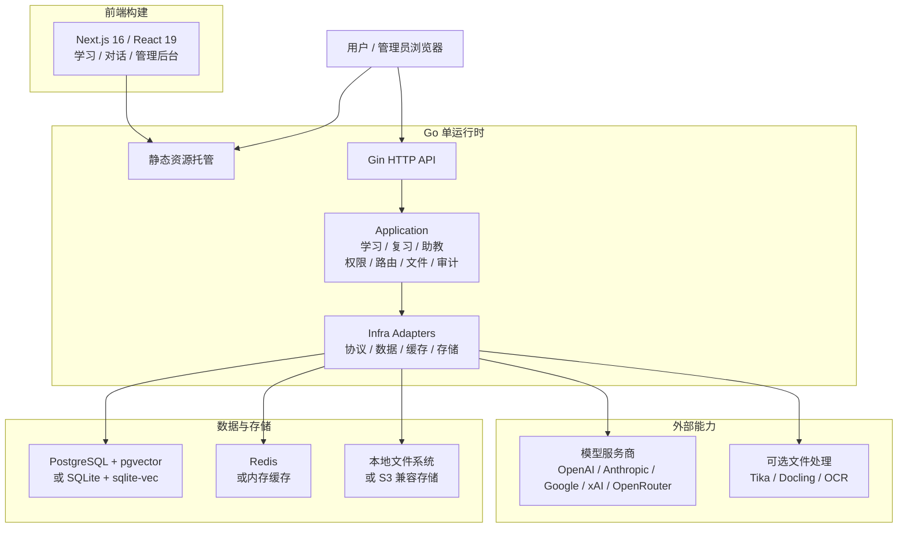

<p align="center">
  <picture>
    <source media="(prefers-color-scheme: dark)" srcset="../apps/web/public/logo-white.svg" />
    
  </picture>
</p>

<p align="center">
  课知伴 — 面向《信号与系统》的 AI 学习伙伴。
</p>

<p align="center">
  <a href="../README.md">English</a> | 简体中文
</p>

<p align="center">
  <a href="https://github.com/WangXingFan/CourseMate"></a>
  <a href="https://github.com/WangXingFan/CourseMate/actions/workflows/ci.yml"></a>
  <a href="https://www.apache.org/licenses/LICENSE-2.0"></a>
  
  
  
</p>

## 项目简介

课知伴是一款可自行部署的开源 AI 学习伙伴，当前围绕 **《信号与系统》** 课程，整合交互式课程、章节实验、课程助教、快问快答和错题复习。学生可以先做预测，再调节信号参数、观察结果，通过变式练习和间隔复习巩固理解。

学习功能复用已有的 AI 对话、教学资料检索、模型路由、账号管理和后台管理能力。浏览器前端与 Go API 可由同一个 Docker 容器提供服务，也可通过 Tauri 桌面客户端访问。

## 学习流程

```text
学习概念 → 先做预测 → 操作实验 → 阅读提示与解释
                                    ↓
按期复习 ← 变式巩固 ← 错因诊断 ← 快问快答
```

## 核心能力

| 模块 | 能力 |
| --- | --- |
| 交互式课程 | 卷积、采样、傅里叶级数、一阶系统、傅里叶变换、拉普拉斯变换、二阶系统、调制八个专题。 |
| 章节实验与助教 | 信号基础、时域、频域、s 域四个实验；作答前提供课程精选提示，作答后提供 AI 解释与课程引用，模型不可用时回退课程内容。 |
| 自定义信号工作台 | 阶跃、有限宽度冲激近似、矩形、指数、正弦五类信号；支持反转、尺度变换、平移，以及 A/B 查看、加、减、乘和数值卷积。 |
| 快问快答与误区诊断 | 12 道基础题、36 类双语误区诊断、24 道服务端评分变式题，以及按账号保存的作答历史。 |
| 间隔复习 | 到期筛选、复习阶段、原题重练和变式巩固；按 1、3、7、14、30 天安排复习，变式答错后重置计划。 |
| 教学资料与 AI 对话 | 知识库检索、可追溯来源、文件解析、流式对话和可配置的模型服务商。 |
| 账号与管理 | 用户和角色管理、模型授权、上游路由、身份认证与审计日志。 |
| 客户端与部署 | 中英文界面、浏览器与 Tauri 桌面端、Docker、SQLite 或 PostgreSQL、内存缓存或 Redis。 |

## 学习入口

登录部署后的站点，即可访问以下路径：

| 路径 | 用途 |
| --- | --- |
| `/learn` | 学习首页与课程专题导航。 |
| `/learn/knowledge` | 52 节课程讲义，均提供课前、课中、课后练习，共 156 道。 |
| `/learn/experiments` | 四个章节实验与提示、解释。 |
| `/learn/workbench` | 自定义信号、变换与组合运算。 |
| `/learn/quiz` | 快问快答与原题练习。 |
| `/learn/progress` | 作答历史、误区诊断、变式练习与到期复习。 |

使用实验中的 AI 解释前，管理员需要配置模型及其上游渠道，并授予账号访问权限。未配置模型时，课程精选提示与回退解释仍可使用。服务启动时自动将 52 份讲义导入共享的“信号与系统”内置知识库，无需手动上传；配置 Embedding 并完成索引后，可在对话中选择该库检索引用。课程讲义和确定性评分练习无需 AI 模型即可使用，导入与更新规则见 [课程内容包](../content/signals/README.md)。

P0（阶段 0–3）已实现，CI 验收记录与数值计算边界见 [P0 交付文档](LEARNING-P0-DELIVERY.zh-CN.md)。统一学习活动记录、分步解题检查、离散时间专题、实验报告与教师学情分析仍在 [后续规划](COURSEMATE-LEARNING-ROADMAP.zh-CN.md) 中。

## 系统架构与技术栈

课知伴 采用前后端分离开发、单运行时部署的结构。前端构建为静态资源后由 Go 服务统一托管，API、权限、模型路由、文件和审计等后端能力由同一个运行时提供；文档提取、OCR 等重型能力以可选服务接入，避免基础部署过重。



| 层面 | 职责 | 主要技术 |
| --- | --- | --- |
| 前端 | 交互式学习、用户对话、后台管理、静态构建 | Next.js 16、React 19、TypeScript、Tailwind CSS、Shadcn/UI、Streamdown、KaTeX、Mermaid、Recharts、Motion |
| 后端运行时 | API、认证授权、业务编排、协议适配、静态资源托管 | Go 1.26、Gin、Gorm、Swagger、OpenTelemetry、Zap |
| 数据与缓存 | 领域数据、向量检索、会话状态、运行时缓存 | PostgreSQL、pgvector、SQLite、sqlite-vec、Redis、内存缓存 |
| 文件与存储 | 上传文件、生成文件、对象存储和本地持久化 | 本地文件系统、S3 兼容对象存储 |
| 文件处理 | 文本提取、OCR、文档解析和 LLM OCR 回退 | 内置提取、Apache Tika、Docling、RapidOCR、Tesseract OCR、Paddle OCR、云 OCR 适配、MinerU |
| 部署运行 | 单节点轻量部署或多节点生产部署 | Docker、Docker Compose、SQLite/内存缓存、PostgreSQL/Redis |

后端内部保持清晰分层：`backend/cmd/server` 是可执行入口，`backend/internal/cli` 负责进程启动，`backend/internal/app` 负责应用装配和依赖注入，`backend/internal/transport/http` 负责 HTTP 边界。请求随后经过 `application` 用例层，依赖消费方定义的 `repository` 或 `ports` 接口，再由 `infra` 提供具体实现。数据层按领域前缀组织表结构，财务流水、审计日志、系统事件和高增长向量数据保持独立事实源。

## 仓库目录

```text
.
├── backend/                  # Go API 与单运行时服务
│   ├── cmd/server/            # 可执行入口
│   ├── internal/
│   │   ├── cli/               # 进程启动
│   │   ├── app/               # 依赖注入与生命周期
│   │   ├── application/       # 用例与业务编排
│   │   ├── domain/            # 业务概念与规则
│   │   ├── ports/              # 外部集成契约
│   │   ├── repository/         # 持久化契约
│   │   ├── infra/              # 持久化、缓存、存储和服务商适配
│   │   ├── transport/http/     # Handler、DTO、中间件和路由
│   │   └── shared/             # 响应、安全等横切代码
│   └── docs/                  # 生成的 Swagger 文件
├── apps/                     # 客户端应用（每个平台一个目录）
│   ├── web/                  # Next.js App Router 与静态导出
│   │   ├── app/              # 路由入口和布局
│   │   ├── features/         # 学习、对话和后台管理等业务流程
│   │   ├── entities/         # 可复用业务实体
│   │   ├── shared/           # API、认证、UI、hooks、模型和工具
│   │   ├── components/       # 基础 UI 与视觉组件
│   │   └── public/           # 静态资源
│   └── desktop/              # Tauri 2 桌面壳：托盘、深链接、自动更新、系统 keychain
├── packages/
│   ├── api-contract/         # 生成的 TypeScript API 契约（所有客户端的唯一来源）
│   └── core/                 # Web / 桌面 / 移动端共享的平台无关客户端逻辑
├── deploy/                    # Docker 部署：compose 方案、配置模板、可选服务
├── docs/                      # 项目指南和截图
└── Dockerfile                 # 前后端生产镜像
```

`apps/web/` 和 `backend/` 是由 pnpm 与 Turborepo 管理的独立工作区。`packages/api-contract/` 通过生成的 Swagger 类型连接两者；修改 HTTP 契约时先更新 Go 传输层，再重新生成共享包。`packages/core/` 存放必须在各端保持一致的客户端逻辑，禁止引入任何 UI 或平台框架。平台边界与规则见 [docs/ARCHITECTURE.md](ARCHITECTURE.md)。

## 开发前置条件

- Node.js 20.9 或更高版本（仓库 Docker 镜像和 CI 使用 Node.js 24）。
- pnpm 10.17.0，通常通过 Corepack 启用。
- Go 1.26.8，用于后端开发。
- Docker Engine 与 Docker Compose v2，用于容器部署或启动本地 PostgreSQL/Redis。

SQLite 方案不要求单独管理数据库或缓存。默认开发配置使用 PostgreSQL 和 Redis；完整 Compose 方案会自动启动这两个服务。

## 快速开始

> 低依赖体验可从 [SQLite Docker 方案](#1-轻量安装sqlite) 开始，部署文件位于 [`deploy/`](../deploy/README.md)。

### 本地开发

本地开发适合改动源码并分别启动前后端。默认配置连接本机 PostgreSQL 和 Redis；如果只是低依赖试用，建议直接使用下面的 Docker 轻量安装。

1. 准备后端配置：

```bash
cp deploy/config.example.yaml config.yaml
```

根据本机环境调整 `config.yaml` 中的 `database.postgres.dsn`、`database.redis.*` 和公开访问地址。

2. 安装工作区依赖并准备前端环境：

```bash
pnpm install
cp apps/web/.env.example apps/web/.env.local
```

3. 同时启动前端和后端：

```bash
make dev
```

`make api`、`make web`、`make desktop` 单独启动某一端；`make help` 列出全部目标。

前端请求后端使用 `NEXT_PUBLIC_API_BASE_URL`。本地开发时确认 `apps/web/.env.local` 中包含：

```env
NEXT_PUBLIC_API_BASE_URL=http://127.0.0.1:8080
```

服务地址与探针：

| 服务 | 地址 |
| --- | --- |
| 前端 | `http://localhost:3000` |
| API | `http://localhost:8080` |
| 存活探针 | `http://localhost:8080/healthz` |
| 就绪探针 | `http://localhost:8080/readyz` |
| 版本接口 | `http://localhost:8080/api/v1/version` |
| Swagger（仅开发环境） | `http://localhost:8080/swagger/index.html` |

不配置 `NEXT_PUBLIC_API_BASE_URL` 时，本地默认指向 `localhost:8080`；同源部署默认请求当前 origin。

### 工作区命令

根目录的 `Makefile` 是唯一入口，所有目标都在仓库根目录执行，底层再分发给 pnpm / turbo / cargo / go：

| 命令 | 用途 |
| --- | --- |
| `make dev` | 以监听模式同时启动前端和后端。 |
| `make api` / `make web` / `make desktop` | 单独启动某一端。 |
| `make check` | 全工作区的 lint、类型、架构与版本检查。 |
| `make test` | 全工作区测试。 |
| `make build` | 静态前端、后端二进制、桌面端（turbo 缓存）。 |
| `make build-desktop` / `make release-desktop` | 本地快速 `.app` / 签名发版包。 |
| `make verify` | check + test + build，即 CI 跑的内容。 |
| `make api-docs` | 重新生成 Swagger 与 TypeScript API 类型。 |
| `make version` | 把 `VERSION` 同步到所有包清单。 |

同一组动作也以 pnpm 脚本存在（`pnpm dev:api`、`pnpm check` …），CI 直接用它们。学习闭环规划相关改动遵循 [验证约束](COURSEMATE-LEARNING-ROADMAP.zh-CN.md#15-github-actions-验证策略)：编译、测试、Lint、类型检查、Docker 构建与 Playwright 均在 GitHub Actions 中执行。

前端以静态资源形式导出，`pnpm build` 会把浏览器产物写入 `apps/web/out`。生产镜像中的 Go 服务，或配置了 `server.frontend_dist_dir` 的 Go 服务，可以直接托管该目录。

### Docker 部署

所有 Docker 部署资源都在 [`deploy/`](../deploy/README.md) 目录；把这个目录整体拷到服务器即可，不需要应用源码。以下命令均在 `deploy/` 目录内执行。先选择安装方案，再把对应的配置模板复制为 `deploy/config.yaml`。三套 compose 方案都默认将应用暴露在 `http://localhost:8081`，并把 `./config.yaml`（相对 `deploy/`）挂载到容器内 `/app/config.yaml`。

CourseMate 使用独立的 Compose 项目 `coursemate`、网络 `coursemate-network` 和 `coursemate-*` 数据卷，不会接管使用 `deeix-chat` 项目名与 8080 端口的旧 DEEIX Chat 部署。如果 8081 已被占用，可设置 `COURSEMATE_HOST_PORT`，并同步修改 `config.yaml` 中的公开 URL 和 CORS origin。

如果之前的 CourseMate 版本已经占用了 `deeix-chat` 资源，请先停止旧栈但不要删除数据卷，并把 `deeix-chat-app-data`、`deeix-chat-app-storage` 复制到新的 `coursemate-app-data`、`coursemate-app-storage` 后再启动。完整迁移命令见 [`deploy/README.md`](../deploy/README.md#migrating-a-previous-coursemate-deployment)。不要同时把两个应用挂载到同一组数据卷；如果旧 DEEIX 数据已被迁移改写，应从部署前备份恢复。

| 方案 | 适合场景 | 配置文件 | Compose 文件 | 内置依赖 |
| --- | --- | --- | --- | --- |
| 轻量安装 | 本地试用、个人部署、小型单节点 | `config.sqlite.example.yaml` | `docker-compose.sqlite.yml` | 仅应用容器，SQLite + sqlite-vec + 内存缓存 |
| 默认安装 | 已有外部 PostgreSQL 和 Redis | `config.example.yaml` | `docker-compose.yml` | 仅应用容器 |
| 全量安装 | 单机同时部署应用、PostgreSQL 和 Redis | `config.full.example.yaml` | `docker-compose.full.yml` | 应用、PostgreSQL、Redis |

#### 1. 轻量安装：SQLite

依赖最少的部署方式，只启动 `app` 容器。数据和本地向量索引使用 SQLite，缓存使用进程内 memory，适合本地试用、个人部署和小型单节点场景。

```bash
cd deploy
cp config.sqlite.example.yaml config.yaml
docker compose -f docker-compose.sqlite.yml up -d
```

SQLite + memory cache 只适合单进程。多节点、高并发或更严格的生产部署建议使用 PostgreSQL + Redis。

#### 2. 默认安装：外部 PostgreSQL + Redis

适合已经有外部 PostgreSQL 和 Redis 的部署环境。启动前需要把数据库和 Redis 地址改成容器内可访问的地址；如果服务在 Docker 宿主机上，通常可以使用 `host.docker.internal`。

```bash
cd deploy
cp config.example.yaml config.yaml
# 修改 database.postgres.dsn、database.redis.* 和公开访问地址
docker compose up -d
```

默认 `docker-compose.yml` 只启动应用容器。除非明确需要覆盖 `config.yaml`，否则不要在 compose 里额外写同名 `environment`。

请为 CourseMate 使用独立的 PostgreSQL 数据库和 Redis 逻辑库，不要把默认方案直接指向旧 DEEIX Chat 的数据库或缓存命名空间。

#### 3. 全量安装：PostgreSQL + Redis 容器

适合希望 compose 同时启动应用、PostgreSQL 和 Redis 的部署方式。

```bash
cd deploy
cp config.full.example.yaml config.yaml
docker compose -f docker-compose.full.yml up -d
```

`docker-compose.full.yml` 会在 compose `environment` 中设置 `POSTGRES_DSN`、`REDIS_ADDR`、`REDIS_USERNAME` 和 `REDIS_PASSWORD`，因此这些值会覆盖 `config.yaml` 里的数据库和 Redis 配置。

#### 配置、持久化和镜像

配置优先级是：`环境变量 > config.yaml > 代码内置默认值`。`config.yaml` 负责品牌和静态基础设施、安全配置，例如品牌资源、服务地址、数据库、缓存、存储、GeoIP、Trace、JWT 和加密密钥。运行时业务配置存储在数据库中，并通过后台管理修改。

默认 compose 会持久化应用数据：

| 数据 | 容器路径 |
| --- | --- |
| SQLite 数据库 | `/app/data/deeix.db`（保留原文件名以兼容已有数据） |
| 上传文件和生成文件 | `/app/storage` |
| PostgreSQL 数据 | `/var/lib/postgresql/data`，仅全量安装 |
| Redis 数据 | `/data`，仅全量安装 |

默认应用镜像为 `ghcr.io/wangxingfan/coursemate:latest`。Compose 文件只引用镜像，不定义构建步骤。测试本地构建时先在仓库根目录生成镜像，再通过 `COURSEMATE_IMAGE` 选择它：

```bash
docker build -t coursemate:local .
cd deploy && COURSEMATE_IMAGE=coursemate:local docker compose up -d
```

使用其他方案时，在启动命令中加入对应的 `-f docker-compose.sqlite.yml` 或 `-f docker-compose.full.yml`。

`APP_ENV` 支持 `dev`/`development` 和 `prod`/`production`，内部会规范化为 `dev` 或 `prod`；未配置时默认 `prod`。`dev` 只用于本地开发；公网生产部署应保持 `APP_ENV=prod` 或 `APP_ENV=production` 并使用生产密钥。

#### 可选安装服务

这些服务不是必须安装。只有在后台或 `config.yaml` 中启用对应文件处理能力时才需要启动。
这些服务位于 `deploy/services/`，会接入 `coursemate-network`；请先启动任一应用 compose 方案，或手动执行 `docker network create coursemate-network`。在 `deploy/` 目录内执行：

```bash
docker compose -f services/tika/docker-compose.yml up -d
docker compose -f services/tesseract/docker-compose.yml up -d --build
docker compose -f services/docling/docker-compose.yml up -d --build
```

默认本地地址：

| 服务 | 地址 | 用途 |
| --- | --- | --- |
| Tika | `http://127.0.0.1:9999` | 文档文本提取 |
| Tesseract OCR | `http://127.0.0.1:8006/ocr` | OCR 服务 |
| Docling | `http://127.0.0.1:8007/ocr` | 文档/OCR 提取 |

`deploy/services/rapidocr` 当前提供 Dockerfile 和服务入口，但还没有 compose 文件。如果选择 RapidOCR，需要自行补 compose 或手动运行。

### 分离部署

当前端和后端分别暴露在不同公网地址时使用分离部署，例如 `https://chat.example.com` 和 `https://api.example.com`。

1. 配置公开地址。

   - 前端构建变量：`NEXT_PUBLIC_API_BASE_URL=https://api.example.com`
   - 后端配置：`server.public_api_base_url=https://api.example.com`
   - 后端配置：`server.public_web_base_url=https://chat.example.com`
   - 后端配置：`server.cors_allow_origin=https://chat.example.com`

   Docker 镜像构建时需要传入前端 API 地址：

   ```bash
   docker build --build-arg NEXT_PUBLIC_API_BASE_URL=https://api.example.com -t coursemate .
   ```

2. 构建并发布前端。

   ```bash
   pnpm install
   NEXT_PUBLIC_API_BASE_URL=https://api.example.com pnpm --filter @deeix/web build
   ```

   静态产物在 `apps/web/out`，可由 Nginx、CDN、对象存储或任意静态服务托管。如需由 Go 后端托管前端，把 `apps/web/out` 放到 `server.frontend_dist_dir` 指向的目录；Docker 镜像默认是 `/app/frontend/out`。

3. 配置 CDN 规则。

   | 路径 | 规则 |
   | --- | --- |
   | `/_next/static/*` | 缓存 1 年，并启用 immutable 静态资源缓存。 |
   | `/logo*.svg`、`/*.ico`、`/*.png`、`/*.jpg`、`/*.webp`、`/*.woff2` | 缓存 1 天到 30 天。 |
   | `/`、`/*.html`、`/login*`、`/auth*`、`/chat*`、`/recent*`、`/files*`、`/knowledge-bases*`、`/library*`、`/settings*`、`/admin*`、`/share*`、`/preview*` | 不做长期缓存，建议使用 `no-cache` 或较短 TTL。 |
   | `/api/*`、`/healthz`、`/readyz`、`/swagger/*` | 绕过 CDN 缓存，并完整转发请求头、方法、查询参数和请求体。 |

   如果 CDN 从对象存储托管 `apps/web/out`，需要开启路由回退，让无扩展名地址能命中导出的 `index.html`，例如 `/chat` -> `/chat/index.html`。

### 启动后检查与首次登录

应用启动后，先确认存活、就绪、挂载配置文件和启动日志。Docker 部署可用：

```bash
curl http://localhost:8080/healthz
curl http://localhost:8080/readyz
docker compose exec app ls -l /app/config.yaml
docker compose logs app
```

只有 `APP_ENV=dev` 或 `APP_ENV=development` 时才会注册 Swagger；生产部署不会暴露 Swagger UI 路由。

如果数据库中还不存在超级管理员，后端会在首次启动时自动创建初始管理员，并且只在创建当次输出一次初始密码。

| 项目 | 说明 |
| --- | --- |
| 初始用户名 | `admin` |
| 初始密码 | 查看后端启动日志，搜索 `bootstrap superadmin created`，读取其中的 `password` 字段。 |
| 首次登录 | 系统会要求修改用户名和密码。 |
| 后续变更 | 通过账户流程或后台管理完成；不会通过 `config.yaml` 修改。 |

如果数据库中已经存在超级管理员，服务不会重新生成或再次输出初始密码。

## 配置说明

> 配置模板：[PostgreSQL + Redis](../deploy/config.example.yaml)、[SQLite](../deploy/config.sqlite.example.yaml)、[全量部署](../deploy/config.full.example.yaml)。

后端配置分为静态运行配置和运行时业务配置。静态运行配置用于描述品牌以及服务启动所需的基础设施、安全和存储参数，由 `config.yaml` 与环境变量提供；运行时业务配置用于认证、会话、模型、文件等产品能力，写入 `system_settings` 并通过后台管理维护。环境变量会覆盖配置文件中的同名项，适合容器化、分离部署和密钥注入场景。

后端启动时会按运行目录解析默认配置文件：从仓库根目录启动读取 `config.yaml`，从 `backend/` 目录启动读取 `../config.yaml`。Docker 部署将 `deploy/config.yaml` 只读挂载到容器内 `/app/config.yaml`；如果配置文件放在其他位置，请使用 `CONFIG_FILE` 指向实际运行环境可访问的路径。最终生效优先级是 `环境变量 > config.yaml > 代码内置默认值`。

前端品牌同样属于运行时配置。在 `config.yaml` 中设置 `branding` 后重启应用即可生效，无需重新构建前端或 Docker 镜像。详见[自定义品牌资源](./BRANDING.md)。

静态配置环境变量：

| 所属域 | 环境变量 | 说明 |
| --- | --- | --- |
| 前端构建 | `NEXT_PUBLIC_API_BASE_URL` | 浏览器请求后端 API 的地址；本地写入 `apps/web/.env.local`，分离部署在构建时传入。 |
| 配置文件 | `CONFIG_FILE` | 可选配置文件路径；Docker 场景应填写容器内路径。 |
| 应用 | `APP_NAME` | 应用名称。 |
| 应用 | `APP_ENV` | 运行环境，支持 `dev`/`development` 和 `prod`/`production`；未配置时默认 `prod`。 |
| HTTP 服务 | `HTTP_PORT` | API/运行时端口。 |
| HTTP 服务 | `CORS_ALLOW_ORIGIN` | 允许跨域访问的来源，多个来源用逗号分隔。 |
| HTTP 服务 | `TRUSTED_PROXIES` | 可信代理 CIDR 列表。 |
| HTTP 服务 | `PUBLIC_API_BASE_URL` | 对外 API 地址，用于链接、回调和公开地址生成。 |
| HTTP 服务 | `PUBLIC_WEB_BASE_URL` | 对外 Web 地址，用于链接、回调和公开地址生成。 |
| HTTP 服务 | `FRONTEND_DIST_DIR` | 前端静态产物目录。 |
| HTTP 服务 | `HTTP_READ_HEADER_TIMEOUT_SECONDS` | HTTP 读取请求头超时。 |
| HTTP 服务 | `HTTP_READ_TIMEOUT_SECONDS` | HTTP 请求读取超时。 |
| HTTP 服务 | `HTTP_IDLE_TIMEOUT_SECONDS` | HTTP keep-alive 空闲超时。 |
| HTTP 服务 | `HTTP_MAX_HEADER_BYTES` | HTTP 请求头最大字节数。 |
| 安全 | `JWT_SECRET` | JWT 签名密钥。 |
| 安全 | `DATA_ENCRYPTION_KEY` | 上游 API Key、SSO Secret、敏感设置和 TOTP Secret 的加密密钥材料。 |
| 安全 | `SSRF_PROTECTION_ENABLED` | 是否启用出站 SSRF 防护。 |
| 安全 | `SSRF_ALLOWED_HOSTS` | 部署级集成或可信私网重定向目标的主机名，逗号分隔。 |
| 安全 | `SSRF_ALLOWED_CIDRS` | 部署级集成或可信私网重定向目标的 CIDR 网段，逗号分隔。 |
| 安全 | `TURNSTILE_SITEVERIFY_URL` | Cloudflare Turnstile siteverify 端点。 |
| 数据库 | `DATABASE_DRIVER` | `postgres` 或 `sqlite`。 |
| PostgreSQL | `POSTGRES_DSN` | PostgreSQL DSN。 |
| PostgreSQL | `POSTGRES_MAX_OPEN_CONNS` | 最大打开连接数。 |
| PostgreSQL | `POSTGRES_MAX_IDLE_CONNS` | 最大空闲连接数。 |
| PostgreSQL | `POSTGRES_CONN_MAX_LIFETIME_MINUTES` | 连接最长生命周期。 |
| PostgreSQL | `POSTGRES_CONN_MAX_IDLE_TIME_MINUTES` | 连接最长空闲时间。 |
| SQLite | `SQLITE_PATH` | 数据库文件路径。 |
| SQLite | `SQLITE_DSN` | 完整 DSN；设置后优先于路径拼装。 |
| SQLite | `SQLITE_MAX_OPEN_CONNS` | 最大打开连接数，默认 `1`。 |
| SQLite | `SQLITE_BUSY_TIMEOUT_MS` | busy timeout。 |
| SQLite | `SQLITE_CACHE_SIZE_KB` | page cache 大小。 |
| SQLite | `SQLITE_MMAP_SIZE_BYTES` | mmap 大小。 |
| SQLite | `SQLITE_SYNCHRONOUS` | 同步模式：`OFF`、`NORMAL`、`FULL`、`EXTRA`。 |
| SQLite | `SQLITE_TEMP_STORE` | 临时存储：`DEFAULT`、`FILE`、`MEMORY`。 |
| 缓存 | `CACHE_DRIVER` | `redis` 或 `memory`；`memory` 仅适用于单进程。 |
| Redis | `REDIS_ADDR` | Redis 地址。 |
| Redis | `REDIS_USERNAME` | Redis ACL 用户名；使用仅密码或默认用户 Redis 时留空。 |
| Redis | `REDIS_PASSWORD` | Redis 密码。 |
| Redis | `REDIS_DB` | Redis DB 编号。 |
| Redis | `REDIS_TLS_ENABLED` | 启用 Redis TLS 连接，例如 Upstash Redis。 |
| Redis | `REDIS_TLS_INSECURE_SKIP_VERIFY` | 跳过 Redis TLS 证书校验；除非非标准端点确实要求，否则保持 `false`。 |
| 存储 | `STORAGE_BACKEND` | `local` 或 `s3`。 |
| 本地存储 | `STORAGE_ROOT_DIR` | 本地文件存储目录。 |
| S3 存储 | `STORAGE_S3_ENDPOINT` | S3 兼容服务 endpoint。 |
| S3 存储 | `STORAGE_S3_REGION` | S3 region；使用 S3 时必填。 |
| S3 存储 | `STORAGE_S3_BUCKET` | S3 bucket；使用 S3 时必填。 |
| S3 存储 | `STORAGE_S3_PREFIX` | S3 对象前缀。 |
| S3 存储 | `STORAGE_S3_ACCESS_KEY_ID` | S3 Access Key ID。 |
| S3 存储 | `STORAGE_S3_SECRET_ACCESS_KEY` | S3 Secret Access Key。 |
| S3 存储 | `STORAGE_S3_FORCE_PATH_STYLE` | 是否使用 path-style 访问。 |
| GeoIP | `GEOIP_PROVIDER` | `none`、`ipwhois`、`ipinfo` 或 `mmdb`。 |
| GeoIP | `GEOIP_BASE_URL` | GeoIP HTTP 服务地址，默认 `https://ipwho.is`。 |
| GeoIP | `GEOIP_TOKEN` | GeoIP 服务 Token。 |
| GeoIP | `GEOIP_TIMEOUT_MS` | GeoIP 请求超时。 |
| GeoIP | `GEOIP_DATABASE_URL` | MMDB 下载地址。 |
| GeoIP | `GEOIP_DATABASE_PATH` | MMDB 本地路径。 |
| GeoIP | `GEOIP_DATABASE_MAX_BYTES` | MMDB 最大下载字节数。 |
| GeoIP | `GEOIP_REFRESH_INTERVAL_HOURS` | MMDB 刷新间隔。 |
| OpenTelemetry | `OTEL_ENABLED` | 是否启用 Trace；未显式设置时，配置 endpoint 会自动启用。 |
| OpenTelemetry | `OTEL_EXPORTER_OTLP_ENDPOINT` | OTLP Collector 地址。 |
| OpenTelemetry | `OTEL_EXPORTER_OTLP_HEADERS` | OTLP 请求头，格式为 `key=value,key2=value2`。 |
| OpenTelemetry | `OTEL_EXPORTER_OTLP_INSECURE` | 是否使用明文传输。 |
| OpenTelemetry | `OTEL_EXPORTER_OTLP_PROTOCOL` | OTLP exporter 协议：`grpc`、`http` 或 `http/protobuf`；默认 `grpc`。 |
| OpenTelemetry | `OTEL_TRACES_SAMPLER_ARG` / `OTEL_SAMPLING_RATE` | Trace 采样率，范围 `0~1`；`OTEL_TRACES_SAMPLER_ARG` 优先。 |

认证、注册、会话配置、模型参数策略、文件处理、RAG、Embedding 等运行时业务配置不属于静态 YAML 配置，默认值由后端种子初始化，并在后台管理中维护。

生产环境启用 SSRF 防护后，管理员保存的模型、Embedding、OIDC/OAuth2 和自定义 Turnstile endpoint 均按精确 origin（协议、主机和端口）获得局部授权，不需要加入全局白名单。模型与 Embedding 保留标准重定向兼容性：跨 origin 的公网目标可以继续访问，跨 origin 的私网目标必须命中 `SSRF_ALLOWED_HOSTS` 或 `SSRF_ALLOWED_CIDRS`；OIDC/OAuth2 与 Turnstile 继续维持更严格的身份边界。全局白名单也继续用于无法绑定管理员保存 endpoint 的部署级集成，例如部分 GeoIP 或提取服务部署。链路本地、组播、未指定地址和已知云元数据目标始终禁止。白名单配置不合法会阻止后端启动；全局白名单修改后需重启生效。

### Web、App 与桌面端 OAuth 回调

第三方登录要求 `PUBLIC_API_BASE_URL` 为外部可访问的 API 地址。每个 OIDC/OAuth2 身份源只需登记后台身份源弹窗展示的这一个服务器回调：

```text
<PUBLIC_API_BASE_URL>/api/v1/auth/providers/<provider-slug>/callback
```

Web、App 与桌面端的登录、注册和账号身份绑定都走这一个回调。外部身份源的授权码和 Client Secret 始终留在用户自己的服务器；公共客户端只会收到一个短时、单次使用并绑定 PKCE verifier 的授权码。未配置 `PUBLIC_API_BASE_URL` 时第三方登录不可用，管理后台会给出提示。

## 功能指南

- [学习入口](#学习入口)：课程、实验、答题与复习。
- [P0 交付文档](LEARNING-P0-DELIVERY.zh-CN.md)：功能行为、API、验收与限制。
- [部署说明](../deploy/README.md)：配置方案与可选服务。

## 安全说明

- 用户密码使用 bcrypt 哈希存储。
- 生产模式会拒绝不安全的默认密钥、过短的加密密钥、通配 CORS 和非 HTTPS 公开地址。
- Refresh Token 和恢复类凭证只存储哈希。
- 上游 API Key、SSO Client Secret、敏感系统设置和 TOTP Secret 使用 `DATA_ENCRYPTION_KEY` 通过 AES-GCM 加密。
- Access Token 为短期令牌并保存在前端内存中；Refresh Token 由后端写入 HttpOnly Cookie。
- 用户输入的模型参数会在请求上游前经过白名单/黑名单过滤。模型名、消息、系统提示词、请求头和 previous response 标识等系统链路字段不允许被用户 options 覆盖。

## 文档入口

- [学习闭环规划](COURSEMATE-LEARNING-ROADMAP.zh-CN.md)
- [P0 交付与验收](LEARNING-P0-DELIVERY.zh-CN.md)
- [多端架构](ARCHITECTURE.md)
- [部署说明](../deploy/README.md)
- [桌面端说明](../apps/desktop/README.md)
- [CourseMate 客户端构建与签名](DESKTOP-COURSEMATE.zh-CN.md)
- 后端说明：[backend/README.md](../backend/README.md)
- API 文档索引：[backend/docs/README.md](../backend/docs/README.md)
- 前端说明：[apps/web/README.md](../apps/web/README.md)
- API 契约包：[packages/api-contract/README.md](../packages/api-contract/README.md)
- 贡献指南：[CONTRIBUTING.md](../.github/CONTRIBUTING.md)
- 安全策略：[SECURITY.md](../.github/SECURITY.md)
- Swagger UI（仅开发环境）：`http://localhost:8080/swagger/index.html`

## 贡献者

- [WangXingFan](https://github.com/WangXingFan)

## 问题反馈

通过 [GitHub Issues](https://github.com/WangXingFan/CourseMate/issues) 提交问题或功能建议。

## 开源协议

课知伴 使用 [Apache License 2.0](../LICENSE) 授权。
